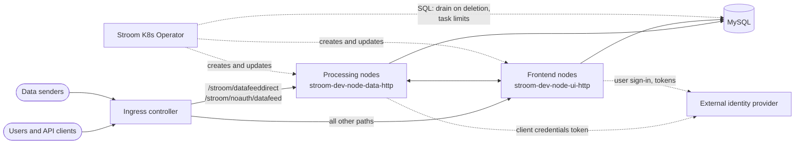

# Architecture

This page explains what the operator manages and what it creates in your cluster. The examples use a
`StroomCluster` named `dev` with two node sets, `data` (role `Processing`) and `ui` (role `Frontend`), in the
namespace `stroom`.

## Custom resources

All resources are in the API group `stroom.gchq.github.io/v1` and are namespaced.

| Kind | Purpose | Required? |
| --- | --- | --- |
| `StroomCluster` | The Stroom nodes, grouped into node sets, plus ingress, TLS, identity provider and Stroom configuration. | Yes |
| `DatabaseServer` | A single-instance MySQL server managed by the operator. | No: you can use an [external database](../database/external-database.md) instead |
| `DatabaseBackup` | A scheduled `mysqldump` of the Stroom databases. | No |
| `StroomTaskAutoscaler` | Adjusts each processing node's task limit based on its CPU usage. | No |

Every field is described in the [CRD reference](../reference/api.md).

## What the operator creates

### For a StroomCluster

| Object | Name | Notes |
| --- | --- | --- |
| ServiceAccount | `stroom-dev` | Used by every Stroom node Pod. Created once and not modified afterwards. |
| ConfigMap | `stroom-dev-static-content` | The default Stroom `config.yml` and the node lifecycle scripts. |
| ConfigMap | `stroom-dev-log-sender` | Only when [log shipping](../configuration/log-shipping.md) is enabled. |
| StatefulSet | `stroom-dev-node-<node set>` | One per node set, for example `stroom-dev-node-data`. |
| Pod | `stroom-dev-node-<node set>-<ordinal>` | For example `stroom-dev-node-data-0`. The Pod name is also the Stroom node name. |
| PersistentVolumeClaim | `data-stroom-dev-node-<node set>-<ordinal>` | One per Pod, from the node set's `localDataVolumeClaim`. |
| Service (headless) | `stroom-dev-node-<node set>` | Gives each node a stable DNS name for node-to-node traffic. |
| Service (ClusterIP) | `stroom-dev-node-<node set>-http` | The Ingress backend for the node set. |
| Ingress | `stroom-dev` | User interface and API traffic. See [Ingress and TLS](../configuration/ingress-tls.md). |
| Ingress | `stroom-dev-datafeed` | Event data sent to the processing nodes. |

Objects the operator creates carry these labels, which are useful with `kubectl -l`:

| Label | Value |
| --- | --- |
| `app.kubernetes.io/name` | `stroom` |
| `app.kubernetes.io/component` | `stroom-cluster` |
| `stroom/cluster` | The `StroomCluster` name, for example `dev` |
| `stroom/nodeSet` | The node set name (Pods and PVCs only), for example `data` |

For example, to list everything belonging to the cluster:

```shell
kubectl -n stroom get statefulsets,pods,services,ingresses,pvc -l stroom/cluster=dev
```

The StatefulSets, Services and Ingresses are reconciled continuously: if you change the `StroomCluster`, the
operator updates them to match. A change that affects the Pod template, such as a new image tag, probe setting or
environment variable, causes a [rolling restart](../operations/node-lifecycle.md#rolling-restarts) of that node
set.

### For a DatabaseServer

For a `DatabaseServer` named `dev`:

| Object | Name | Notes |
| --- | --- | --- |
| Secret | `stroom-dev-db` | Generated passwords under the keys `root` and `stroomuser`. Not deleted with the `DatabaseServer`. |
| ConfigMap | `stroom-dev-db` | The MySQL `my.cnf`. |
| ConfigMap | `stroom-dev-db-init` | Scripts that create the databases on first start. |
| StatefulSet | `stroom-dev-db` | One replica, Pod `stroom-dev-db-0`. |
| PersistentVolumeClaim | `data-stroom-dev-db-0` | From `spec.volumeClaim`. |
| Service (headless) | `stroom-dev-db-headless` | Port 3306. |

Unlike the `StroomCluster` objects, these are only created, never updated. See
[Operator-managed DatabaseServer](../database/database-server.md#changing-a-databaseserver).

### For a DatabaseBackup

A CronJob named `stroom-<name>-db-backup`. See [Backups](../database/backups.md).

## How traffic flows



- The Ingress sends event data to the processing node set and everything else (the user interface and the API)
  to the frontend node set. See [Ingress and TLS](../configuration/ingress-tls.md#routing).
- Nodes talk to each other directly, using the stable DNS names provided by the headless Services.
- Each Stroom node exposes three ports: `8080` (HTTP), `8443` (HTTPS, when [`spec.https`](../configuration/ingress-tls.md#https-inside-the-cluster)
  is set) and `8081` (the Dropwizard admin port, used by the health probes).

## How the operator interacts with Stroom

The operator works with Stroom in two ways:

1. **Lifecycle scripts inside each node Pod.** The startup probe runs a script that enables the node and its
   managed jobs through the Stroom API, and a `preStop` hook disables them and waits for the node's active tasks
   to finish before the container is stopped. Both scripts authenticate with a token obtained using the client
   credentials in `spec.openId`. See [Node lifecycle](../operations/node-lifecycle.md).
2. **Direct SQL connections to the Stroom database** from the operator Pod. These are used to drain the whole
   cluster when a `StroomCluster` is deleted, and by the `StroomTaskAutoscaler` to read and set task limits. The
   operator Pod therefore needs network access to the database on port 3306.

The operator watches resources in all namespaces.
